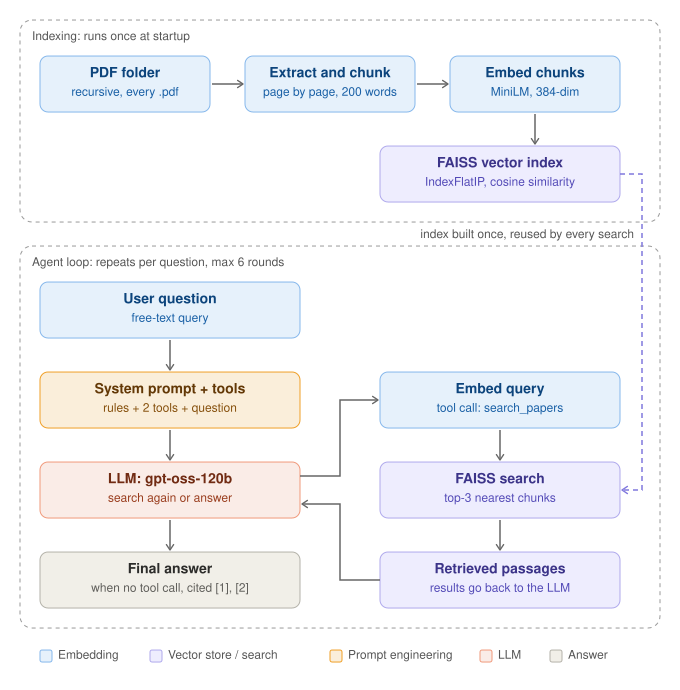

# CPU_rag: agentic RAG over your PDFs (FAISS + Groq)

Ask questions about a folder of PDFs (subfolders included) and get answers that cite the file and passage they came from. Embedding and search run locally on CPU; the answering model runs on [Groq](https://groq.com).

The repo has two parts:

1. **An agentic RAG system**: the LLM gets a search tool and decides what to search for, how many times, and when it has enough evidence, instead of retrieving once.
2. **An automated evaluation** that compares it with a plain single-shot RAG and a no-retrieval baseline on accuracy, latency and token cost. It generates its own synthetic corpus and questions, so it needs no PDFs and runs the same way every time.



## How it works

**Indexing (once, at startup).** Every `.pdf` under the folder is found, text is extracted page by page, split into overlapping 200-word chunks (file name and page are kept), embedded with `all-MiniLM-L6-v2`, and stored in a FAISS inner-product index (cosine similarity). The index lives in memory and is rebuilt on every run.

**Agent loop (per question).** The LLM is given a system prompt and a list of tools. Each round it replies with either a tool call or a final answer. Tool results are added to the conversation and the model is called again, up to 6 rounds. The sections below explain this in detail.

| Tool | What it does |
|---|---|
| `search_papers(query)` | Embeds the query, returns the top-3 nearest chunks from the index as numbered passages with file and page |
| `list_papers()` | Lists the files in the library |
| `search_web(query)` | Optional DuckDuckGo search, **off by default** (`--web` to enable; the model-written query leaves your machine) |

**Single-shot baseline** (`single_shot_rag.py`): embed the question as typed, retrieve the top-k chunks once, build one prompt, make one LLM call.

## Normal RAG vs agentic RAG

Both use the same documents, chunks, embedding model and FAISS index. The difference is who controls the search. The measured rows come from the benchmark in [Evaluation](#evaluation) (seed 42, 25 questions, `gpt-oss-120b`).

| | Normal (single-shot) RAG | Agentic RAG |
|---|---|---|
| **Control flow** | Fixed pipeline: retrieve, build prompt, answer | A loop: the LLM chooses the next action every round |
| **Search query** | The user's question, exactly as typed | Written by the LLM: short, specific, different for each search |
| **Number of searches** | Always 1 | 0 to several. Measured: 1 for simple questions, 2-3 for multi-hop |
| **Who decides what to retrieve** | Your code | The LLM, through tool calls |
| **Passages the LLM sees** | Top-5 chunks from one search | 3 chunks per search, accumulated (up to 9 in the benchmark) |
| **LLM calls per question** | 1 | 2 or more (2.7 on average) |
| **If the first results are poor** | Answers from what came back, or says "I don't know" | Can reword the query and search again |
| **Multi-hop questions** | Weak: the second fact is usually not retrieved. 2/10 correct; all needed documents retrieved for only 2/10 | Strong in this benchmark: 10/10 correct; all needed documents retrieved for 10/10 |
| **Simple questions** | 10/10 | 10/10 (same accuracy) |
| **Unanswerable questions** | 5/5 abstained | 5/5 abstained, but uses more tokens before giving up (1,681 vs 517) |
| **Typical failure** | Retrieval miss, so "I don't know" | Wasted rounds and extra tokens; depends on the model's tool-calling ability |
| **Tokens per question** | 553 | 1,720 (3.1x) |
| **Latency per question** | 0.5 s | 1.1 s (2.4x), excluding rate-limit waits |
| **Cost per question** | $0.00010 | $0.00031 |
| **Cost per correct multi-hop answer** | $0.00055 | $0.00043 |
| **Predictability** | High: the same steps every time | Lower: the model's choices vary between runs |
| **Extensible** | No | Yes: add a tool (web, list files, ...) without changing the loop |
| **Use it for** | Direct lookup questions | Multi-part or chained questions, mixed sources |

In short: on simple questions the agent gives the same accuracy at about twice the cost, so it only pays off when a question needs more than one search.

## The agent loop, step by step

All of this is in `agentic_rag.py`. The names in brackets are the functions and constants involved.

1. **Index the documents once** (`build_knowledge_base`). The result is the knowledge base: chunk texts with file and page, the FAISS index, and the embedding model.
2. **A question arrives** (`AgenticRAG.ask`). The evidence list and the token counters are reset, and the conversation starts as two messages: the system prompt and the user's question.
3. **Ask the LLM what to do** (`call_llm`, `groq_chat`). One request goes to Groq containing the conversation so far, the list of tools, `tool_choice: "auto"`, `temperature: 0.1`, `max_tokens: 1200` and `reasoning_effort: "low"`. Groq returns the model's reply together with the token usage, which is recorded.
4. **Read the reply.** If it contains no tool call, the model has decided it has enough evidence. Go to step 9.
5. **Keep the model's turn in the conversation.** The assistant message with its `tool_calls` is appended. This is required: the tool results that follow must refer back to it.
6. **Run each requested tool** (`run_tool`). The tool name and its JSON arguments are read from the reply and the matching Python function runs. For `search_papers` (`tool_search_papers`): embed the query, take the 3 nearest chunks from FAISS, number them, and format them as text.
7. **Give the result back.** A message `{"role": "tool", "tool_call_id": ..., "content": <passages>}` is appended.
8. **Repeat from step 3**, at most `MAX_STEPS` (6) times. If the cap is reached, a final message ("Step limit reached. Give your best answer now...") is added and the model is called once more without tools, so it must answer.
9. **Finish.** Citation markers some models emit (`【5†L1-L4】`) are rewritten to `[5]`. The answer is printed with the list of passages it cites and the call and token counts.

### How the model decides which tool to use

The code contains no routing logic: it never inspects the question to choose a tool. The model decides, using only two pieces of text that are sent with every request.

**1. The tool definitions.** Each tool is described to the model as a name, a one-sentence description and the arguments it takes:

```json
{
  "type": "function",
  "function": {
    "name": "search_papers",
    "description": "Semantic search over the document library. Returns numbered passages with source file and page.",
    "parameters": {
      "type": "object",
      "properties": { "query": { "type": "string", "description": "Short search query." } },
      "required": ["query"]
    }
  }
}
```

**2. The system prompt rules** (from `build_system_prompt`, web search off):

```
1. Break complex questions into sub-questions and search for each one separately. If a question needs a
   fact that depends on another fact (for example 'the leader of X'), first find the intermediate fact,
   then search for the next one.
2. Use short, specific search queries (key terms, not full sentences).
3. If the results do not contain the answer, try a differently worded query before giving up.
   Use at most 4 searches in total.
4. Answer ONLY from the passages returned by the tools. Cite them as [1], [2], etc.
5. If the passages do not contain the answer, say so clearly instead of guessing.
6. Only call list_papers if the user asks which files exist.
```

With `tool_choice: "auto"` the model either writes ordinary text, which is the final answer, or writes a tool call: a tool name plus arguments as JSON. Which one it picks, and what query it writes, comes from the model's training for function calling combined with the text above:

| Situation | What the model does | What guides it |
|---|---|---|
| A question about the content of the documents | Calls `search_papers` with a short query | Tool description, rule 2 |
| The answer depends on an intermediate fact ("the leader of X") | Searches for the intermediate fact, reads the result, then searches again | Rule 1 |
| The first results do not contain the answer | Rewords the query and searches again, up to 4 searches | Rule 3 |
| The user asks which papers exist | Calls `list_papers` | Rule 6, tool description |
| A question about current events or facts outside the documents (only with `--web`) | Calls `search_web` | Web-only rules: documents first, web only when needed |
| The passages already contain the answer | Makes no tool call and answers with citations | Rule 4 |
| The passages do not contain the answer | Makes no tool call and says so | Rule 5 |

Notes on how this behaves in practice:

- `search_web` is added to the tool list only when you pass `--web` and the search package is installed. Otherwise the model does not know it exists.
- The "at most 4 searches" rule is an instruction to the model, not enforced in code. The hard limit in code is `MAX_STEPS = 6` rounds.
- If the model asks for a tool that does not exist, the string `Unknown tool: ...` is returned to it as the tool result. A tool that raises an error returns `Tool error: ...`. Invalid JSON arguments are treated as empty. In each case the model can recover on the next round instead of the program crashing.
- The tool's `k` argument (number of passages) is still in the schema but the code ignores it and always returns 3; see the next section for why.

### Example trace (illustrative)

This is one of the benchmark's multi-hop questions. The documents are real (from `results/seed42/corpus/`), but the exact queries the model writes vary from run to run, so treat the trace as an illustration of the mechanism.

```
Question: Who leads the flagship project of the Brisnar Institute?

Round 1  LLM -> tool call   search_papers({"query": "Brisnar Institute flagship project"})
         tool result        [1] (source: lab_brisnar_institute.txt, page 1)
                            ...Today the Brisnar Institute employs 813 researchers. Its flagship effort
                            is Project Cobalt, which receives most of the institute's attention...
                            (plus two other chunks)

Round 2  LLM -> tool call   search_papers({"query": "Project Cobalt leader"})
         tool result        [4] (source: project_cobalt.txt, page 1)
                            ...The project is led by Zora Ivanova. The training dataset of Project Cobalt
                            contains 58,000 samples...
                            (plus two other chunks)

Round 3  LLM -> no tool call, final answer:
         "Zora Ivanova leads Project Cobalt, the flagship project of the Brisnar Institute [1][4]."
```

The question names only the institute. The leader's name sits in a different document that never mentions the institute, so a single search on the question's words is unlikely to find it. The agent first finds the project's name, then searches for the project. A single-shot system cannot do the second step.

## Staying within the token limit

The free Groq tier limits `gpt-oss-120b` to **8,000 tokens per minute**. An agent is exposed to this because every round re-sends the whole conversation (system prompt, tool definitions, all earlier tool results), and because the limit counts the tokens you *request*: the prompt plus the `max_tokens` you reserve for the reply, even if the reply is shorter.

The first version of the agent failed on exactly this. After four searches the request was too large and Groq returned an error: limit 8,000, already used 6,780 in that minute, requested 6,485.

What was done about it:

| Problem | What the code does | Where |
|---|---|---|
| The model asked for 5 passages per search, so every tool result (and every later round) was large | Always return 3 passages and ignore the model's `k` | `CHUNKS_PER_SEARCH`, `tool_search_papers` |
| Near-identical queries returned the same passages again | A passage already sent is replaced by `[n] already shown above`, and its number is reused so citations stay consistent | evidence list in `tool_search_papers` and `tool_search_web` |
| `max_tokens: 2500` was reserved on every call and counted against the per-minute budget even when unused | Reply limit lowered to 1,200 | `MAX_OUTPUT_TOKENS` |
| A reasoning model spends tokens thinking before it answers | `reasoning_effort: "low"` | `REASONING_EFFORT` |
| Wasted rounds (calling `list_papers` first, rewording needlessly) | Prompt rules: at most 4 searches, `list_papers` only when asked; hard cap of 6 rounds, then a forced final answer | `build_system_prompt`, `MAX_STEPS` |
| Web snippets can be long | At most 3 results, each cut to 600 characters | `tool_search_web` |
| The limit is still hit sometimes | On a 429 error the code reads the "try again in Xs" time from the message, sleeps, and retries (up to 4 waits). The waiting time is recorded separately so latency measurements stay honest | `groq_chat` |

Two more details apply to the evaluation only: its documents are chunked into short 60-word pieces, and the judge runs on a different model (`gpt-oss-20b`), which has its own limit.

What this does and does not achieve:

- It reduces the pressure but does not remove it. In the benchmark run the agent still waited 183 seconds in total across 25 questions. On a paid tier those waits would not occur.
- The token usage per question is the structural cost of the approach: about 1,100 tokens for a simple question (2 calls), 2,400 for a multi-hop one and 1,700 for an unanswerable one, against about 550 for single-shot.
- Each measure trades something: a fixed 3 passages per search can miss needed context, and low reasoning effort can lower answer quality on harder questions. The individual measures were not benchmarked separately; the combination is what made the runs complete.

## Quick start

Python 3.10 or newer.

```bash
git clone https://github.com/Rimas-Codes/CPU_rag.git
cd CPU_rag

python -m venv .venv
.venv\Scripts\activate            # Windows   (macOS/Linux: source .venv/bin/activate)

pip install torch --index-url https://download.pytorch.org/whl/cpu
pip install -r requirements.txt
```

Get a free API key at [console.groq.com/keys](https://console.groq.com/keys) and provide it in one of these ways (never commit it):

- an environment variable: `GROQ_API_KEY=gsk_...`
- a `.env` file: copy `.env.example` to `.env` and edit it (`.env` is git-ignored)
- or paste it when the script asks

Run it:

```bash
python agentic_rag.py --folder "path/to/your/pdfs"                 # interactive
python agentic_rag.py --folder "path/to/your/pdfs" -q "Your question"
python agentic_rag.py --folder "path/to/your/pdfs" --web           # also allow web search

python single_shot_rag.py --folder "path/to/your/pdfs"             # the plain baseline
```

Without `--folder` it uses `./pdfs` (or the `RAG_PDF_FOLDER` environment variable). The default model is `openai/gpt-oss-120b`; change `GROQ_MODEL` at the top of `agentic_rag.py` if it is not available on your account.

## Evaluation

```bash
python rag_eval.py --per-category 2    # quick smoke test
python rag_eval.py                     # full run: 25 questions x 3 systems
python rag_eval.py --systems single,agentic
```

**What it generates.** A made-up world of 12 fictional institutes with projects, lead researchers and universities, written out as 44 short documents. Names are fictional, so no model can answer from training data. It then writes 25 questions with known answers:

- **10 simple**: the answer is in one document.
- **10 multi-hop**: the answer needs 2-3 documents chained together. The entity in the question appears only in the first document ("Who leads the flagship project of the Brisnar Institute?"), so a single search on the question's words is unlikely to find the second document.
- **5 unanswerable**: about real entities, but the fact was never written down (budget, programming language, current director, thesis title, a non-existent institute). A good system says it does not know.

**Systems compared.** `closed` (LLM alone, a sanity check that the data is not leaked), `single` (top-5 chunks, one call), `agentic` (this repo's agent, web search off).

**Judging.** A different model (`gpt-oss-20b`) compares each answer with the known gold answer. For unanswerable questions an answer counts as correct only if it abstains and states no specific answer. The judge's reason is saved for every question in `results.jsonl`.

**Results** (seed 42, answering model `gpt-oss-120b`; full tables in [`results/seed42/summary.md`](results/seed42/summary.md)):

| System | Overall | Simple | Multi-hop | Unanswerable | Latency (s) | Tokens / question | $ / question |
|---|---|---|---|---|---|---|---|
| closed-book | 4/25 (16%) | 0/10 | 0/10 | 4/5 | 0.4 | 157 | 0.00004 |
| single-shot | 17/25 (68%) | 10/10 | 2/10 | 5/5 | 0.5 | 553 | 0.00010 |
| **agentic** | **25/25 (100%)** | 10/10 | **10/10** | 5/5 | 1.1 | 1,720 | 0.00031 |

95% confidence intervals: overall 48-83% (single-shot) vs 87-100% (agentic); multi-hop 6-51% vs 72-100%. Latency excludes time spent waiting on Groq free-tier rate limits.

What the numbers show:

- Single-shot is as good as the agent on simple questions. It fails multi-hop questions mostly by retrieving the first document but not the second: the needed documents were all retrieved for only 2 of 10 multi-hop questions (the agent: 10 of 10). Its failures are "I don't know", not hallucinations.
- The agent adapts its effort: 1 search for every simple question, 2-3 for multi-hop (matching the length of the chain).
- It costs about 3x the tokens and 2.4x the latency of single-shot, and about twice as much on simple questions where it gains nothing. On multi-hop questions it is cheaper per correct answer ($0.00043 vs $0.00055).
- The closed-book baseline scores 0/20 on answerable questions, confirming the benchmark cannot be solved from model knowledge.

**Read these results with care.**

- The benchmark is synthetic, clean and small (44 documents, 25 questions). Real PDFs are messier, so absolute scores will be lower.
- The multi-hop questions were designed so that one search cannot find the second document, so the 20% vs 100% gap demonstrates the mechanism, not a general real-world gap.
- The single-shot baseline retrieves 5 chunks; in this run the agent saw up to 9 across its searches. A single-shot control with a larger k would show how much of the gain is just "more chunks" rather than iterative search (not run yet).
- With 5-10 questions per category, differences of one or two questions are noise.
- The judge is an LLM and can be wrong; spot-check `results.jsonl`.
- Token prices are set in `PRICES` in `rag_eval.py`; check Groq's pricing page.

Results are saved after every question, so an interrupted run resumes where it stopped (`--fresh` starts over, `--seed N` generates a different corpus and question set).

## Project structure

```
agentic_rag.py        indexing + Groq client + agent loop + CLI
single_shot_rag.py    single-shot baseline (also used by the evaluation)
rag_eval.py           synthetic corpus, questions, LLM judge, metrics, report
tests/                unit tests (no API key or network needed): pytest -q
results/seed42/       corpus, questions, per-question results and summary of the run above
docs/                 block diagram
```

## Limitations and ideas

- Scanned PDFs have no text layer and are skipped (no OCR).
- The index is rebuilt in memory on every run; caching it to disk would remove the start-up wait on large libraries.
- Fixed-size word chunks ignore paper structure (sections, tables, figures). No reranking and no hybrid (keyword + vector) search.
- Retrieval returns a fixed 3 chunks per search call (the tool schema still lists `k`, which is ignored: removing it from the schema is a cleanup that would change the prompt, so it was left as it was in the evaluated run). The free Groq tier's token-per-minute limit is the main constraint on latency.
- Not done yet: single-shot control with larger k, evaluation on real papers, multiple seeds averaged, a page-restricted search tool.

## Troubleshooting

- **`OSError: [WinError 1114] ... c10.dll`** when importing torch: install the CPU build in a clean environment (command in Quick start) and make sure your IDE uses that environment.
- **The script seems to hang after the embedding step**: it is waiting for the API key. Set `GROQ_API_KEY`, or paste the key into the console.
- **`Groq API error 404 ... model_not_found`**: the model is not available on your account; set another one in `GROQ_MODEL`.
- **`429` rate limit messages**: normal on the free tier; the script waits and retries.

## License

MIT, see [LICENSE](LICENSE).
